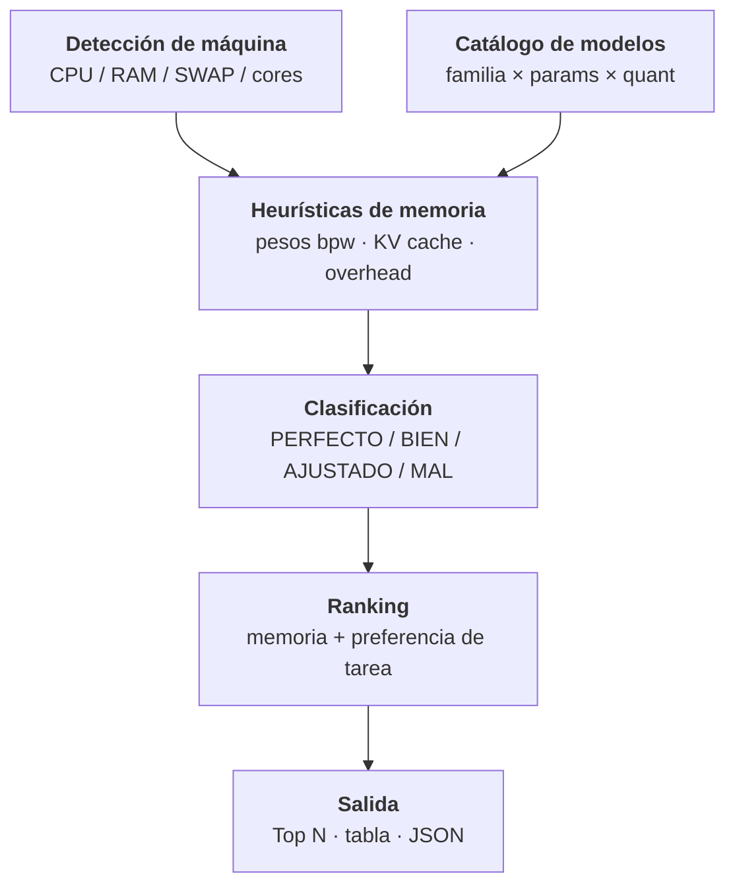

# llm-consultor

Analizador de tu máquina local (CPU/RAM/SWAP) que **recomienda modelos GGUF** para ejecutar LLMs en local (llama.cpp / Ollama / LocalAI), clasificando cada combinación como **PERFECTO / BIEN / AJUSTADO / MAL**.

[](https://python.org)

## Contenido

- [Características](#características)
- [Arquitectura](#arquitectura)
- [Stack](#stack)
- [Instalación](#instalación)
- [Uso](#uso)
- [Configuración](#configuración)
- [Salida](#salida)
- [Roadmap](#roadmap)
- [Licencia](#licencia)

## Características

- Detección automática de **SO, arquitectura, CPU, núcleos, RAM y swap** (usa `psutil`; fallback sin dependencias).
- Estimación de memoria con heurísticas conservadoras:
  - **Pesos**: `params × (bits_per_weight / 8)` según el quant (`Q2_K … Q8_0`, `F16`).
  - **KV cache**: `layers × hidden × ctx × bytes × 2` (con fallback proporcional a parámetros).
  - **Overhead**: base + 10% del peso de los pesos.
- Catálogo curado de modelos populares (Llama, Qwen, Mistral, Gemma, Phi, DeepSeek, CodeLlama, TinyLlama).
- Clasificación de ajuste: `PERFECTO ≤ 60%`, `BIEN ≤ 80%`, `AJUSTADO ≤ 95%`, si no `MAL`.
- **Ranking** por memoria total requerida y preferencia de tarea (`general`, `coding`, `reasoning`, ...).
- Hint de capacidad de la CPU (`AVX-512` / `AVX2` / `AVX` / sin AVX).
- Exportación opcional de resultados a **JSON**.

## Arquitectura



## Stack

- Python 3
- Opcionales: `psutil` (sensores de sistema), `tabulate` (tablas bonitas)

## Instalación

```bash
git clone https://github.com/bi0punk/llm-consultor.git
cd llm-consultor
pip install psutil tabulate   # ambos opcionales
```

## Uso

```bash
python app.py                            # Top 25 recomendaciones con defaults
python app.py --ctx 4096 --headroom 0.30
python app.py --prefer coding --quants Q4_K_M,Q8_0 --top 10
python app.py --json-out reporte.json    # exporta el analisis completo
```

## Configuración

| Argumento     | Default            | Descripción                                        |
|---------------|--------------------|----------------------------------------------------|
| `--ctx`       | `2048`             | Longitud de contexto (la KV cache escala con esto) |
| `--headroom`  | `0.25`             | Reserva de RAM: `0.25` = usar 75%                  |
| `--quants`    | `Q4_K_M,Q5_K_M,Q8_0` | Quants separados por coma                       |
| `--kv-bytes`  | `2`                | Bytes por elemento de KV cache (2 = fp16)          |
| `--kv-factor` | `1.20`             | Factor conservador KV (≥ 1)                        |
| `--prefer`    | `any`              | Preferencia de tarea (`general/coding/reasoning/…`)|
| `--top`       | `25`               | Número de recomendaciones                          |
| `--json-out`  | `""`               | Ruta de exportación JSON                           |

## Salida

- Cabecera con el resumen de la máquina y el presupuesto de RAM.
- Tabla con: `FIT`, `MODELO`, `TAREA`, `PARAMS`, `QUANT`, `RAM EST.`, `DESGLOSE` (W/KV/OH) y `NOTAS`.
- Avisos de riesgo: CPU sin AVX2 (recomienda ≤ 3B), swap saturada, RAM baja libre.

## Roadmap

- [x] Detección completa de la máquina
- [x] Heurísticas de pesos, KV cache y overhead
- [x] Catálogo de ~35 modelos con hints de arquitectura
- [x] Clasificación y ranking con preferencia de tarea
- [x] Exportación JSON
- [ ] Soporte de NVIDIA/vRAM (models GPU + offload)
- [ ] LLM backend detectado automáticamente (llama.cpp/Ollama/LocalAI)
- [ ] Recomendación de comandos de descarga listos para copiar

## Licencia

Sin archivo `LICENSE` declarado en el repositorio.